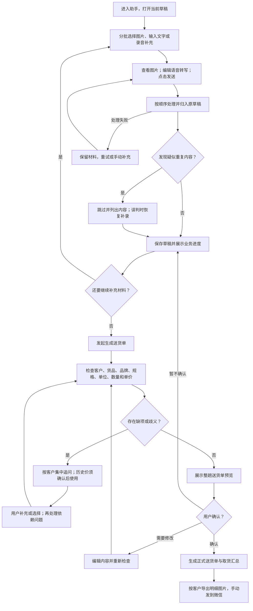
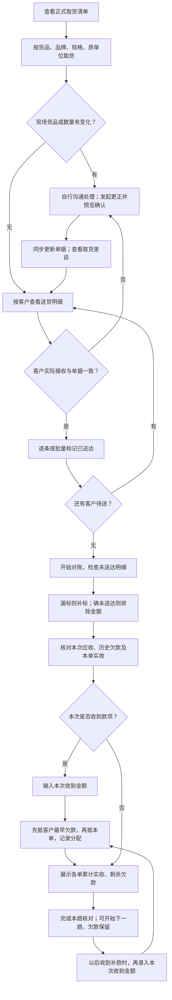
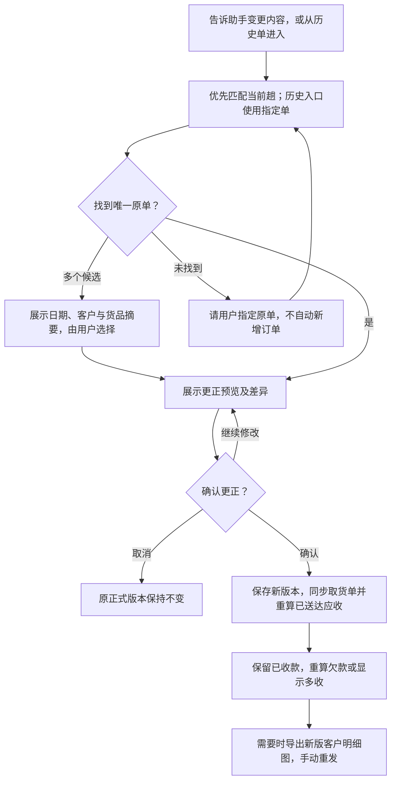

# 需求分析文档

> 项目：Dispatch Agent｜整理日期：2026-11-15｜用途：合并分析与范围建议。当前实现与验收见[开发任务](开发任务.md)。
>
> 来源 A：[Dispatch Agent 需求分析](./Dispatch%20Agent%20需求分析.md)
> 来源 B：[Dispatch Agent 项目访谈记录](./Dispatch%20Agent%20项目访谈记录.md)
>
> 同一事项以来源 B 更新后的「已确认」规则为准；来源 A 的分析推断不升级为用户承诺。本文新增的优先级和实施拆分均为建议。

## 1. 需求背景

### 1.1 用户与问题

使用者是独自完成录单、仓库取货、逐家配送和收款登记的速冻食品配送员。客户通常晚上通过微信文字、语音、截图报单，配送员需要在次日出发前整理成送货单，目前每晚耗时约 3～4 小时。每天约 5～20 家客户，每家约 3～10 种货品。

工作负担包括理解追加与修改、辨认客户简称和货品、查询不同客户的成交价、抄写单据，以及送货后的应收、实收和欠款核算。现场缺货、客户少收货、单价写错等变化会继续影响单据和账目。

产品目标是让配送员沿着「录单 → 确认出单 → 取货 → 送货 → 对账」完成一趟工作，减少重复抄写和手算。长期目标是将每晚整理控制在一小时以内，理想半小时；该目标尚未实测。

### 1.2 定位与交付边界

- **目标产品**：安卓手机上的微信小程序。每个账号独立管理自己的业务数据和聊天记录，同一人完成四个环节。
- **首轮交付**：使用模拟数据的可交互原型，验证完整流程和业务规则。识别、录音和登录可模拟，但应明确标识；按钮、修改、金额和状态变化应真正联动。
- **后续试用**：接入真实图片识别、语音、存储和账号隔离，取得真实样本后再验证准确性、设备体验与省时目标。

原分析的「第一版先不靠识别」用于控制技术风险，不应据此删掉访谈已确认的图片、语音入口。首轮模拟这些入口，同时提供文字补充和可编辑预览；真实识别在试用阶段接入。

原分析提出的离线操作是建议，访谈未确认；不纳入首轮必做。市场空档、利润率、差错率、流水和成本估算缺乏本轮核验，不作为立项或验收依据。单人使用也不意味着正式产品可以取消账号间数据隔离。

## 2. MVP 最小可行功能点

### 2.1 最小范围

建议首轮只实现三个业务页面：**聊天助手、取货清单、送货与对账**。预览、更正、历史单选择和客户图片导出用弹层或详情承载，不增加独立后台。保留一个正在整理的草稿及少量历史样例，足以演示历史价格、补款和更正。

这里的 MVP 指首轮模拟原型。它要完整展示访谈约定的核心操作，暂不承担真实生产使用。跨单抵扣和更正虽然比简单录单复杂，但直接决定账目是否正确，不应为了缩小范围而删除。

| 编号 | 核心功能 | 首轮必须达到的行为 | 依据 |
|---|---|---|---|
| M01 | 连续录入与草稿 | 支持模拟选图、语音转文字及文字输入；可查看图片、编辑转写文本；分批材料进入同一草稿，按批次顺序处理。普通发送不直接正式出单 | B Q06、09～12、19 |
| M02 | 集中补充与消歧 | 发起生成送货单后集中检查缺项；按客户提示独立问题，有依赖的后问；数量追加、品牌、客户归属不明确时由用户确认。补充后重新检查 | B Q13、16～18、25 |
| M03 | 基础记忆与查价 | 边录单边建立客户、货品；确认客户别名后关联同一客户。按同客户、货品、品牌、规格、单位查历史价，展示来源日期，经确认才沿用；无历史则手填，不套用其他客户价格 | B Q03、14～15、22、25～26 |
| M04 | 正式出单 | 全部客户补齐后统一预览；允许编辑并重新预览，确认才生成正式单。按上传顺序排列客户，展示明细金额和客户合计 | B Q10、17～18、32 |
| M05 | 取货汇总 | 从正式单按货品、品牌、规格、单位汇总数量；箱与袋分行，不换算；只查看，不做逐项取货勾选 | B Q28～30 |
| M06 | 配送状态 | 按明细标记未配送、已送达；支持对指定单据批量标记的模拟语音指令。现场少收先更正数量，不新增部分送达状态 | B Q33～34 |
| M07 | 对账与收款 | 核实未送达项后仅按已送达明细核算；录入每次收到的金额，按客户最早欠款优先分配，展示本单应收、累计实收、剩余欠款及历史欠款 | B Q36～39 |
| M08 | 更正与联动 | 从助手或历史单发起更正；匹配不唯一时选择原单，未找到则指定原单；预览确认后更新送货单、取货单、应收和欠款，显示版本与变更内容 | B Q20、30～31、40～42 |
| M09 | 客户核对图片 | 按客户生成可保存的明细图片，包含当前版本；用户在微信手动发送。更正后重新导出，旧图不会自动更新 | B Q35、40；版本标识为 A 的建议 |
| M10 | 基础反馈与可恢复 | 展示识别中、待补充、待确认、失败等业务状态；疑似重复内容跳过并说明，可恢复补录；失败保留草稿、可重试或改为手动补充 | B Q21、43；失败恢复为实施建议 |

首轮历史匹配、识别和意图解析可以使用固定案例，但不能把未覆盖的输入伪装成识别成功。原型建议保留刷新后的草稿与业务状态，并提供显式重置演示数据入口。

### 2.2 不能简化掉的业务规则

1. **金额口径**：出单展示订单金额；对账的本次应收只等于已确认送达明细的数量乘单价之和。未送达金额不计入本次应收。金额按分计算，避免浮点累计误差。
2. **历史与本次分开**：历史欠款不叠加进本次货品应收。本单累计实收指分配到该单的金额，不等于客户本次支付总额。
3. **跨单收款**：每笔收款只登记一次，默认先抵最早欠款，再抵本单；保存收款记录及分配明细，重复点击不得重复入账。独立流水页面可后置，底层记录不能省略。
4. **更正保留收款**：更正已结清单不能抹掉已收款。应收从 200 改为 220，已收 200，则欠 20；应收改为 180，则显示多收 20，不自动抵后续货款，不做退款登记。
5. **旧欠款可选补录**：不要求初始化全部历史账；有需要时补录，纳入后续抵扣，不能重复建立同一笔欠款。
6. **单据确认一致**：预览未确认时，正式送货单、取货单与正式账目不变；确认更正后一起更新。确认、收款操作应防重复提交。
7. **草稿归属固定**：迟到的识别结果仍归原草稿，不能误写到下一趟。对完账可以开下一趟，不要求所有客户付清。
8. **现场变化**：缺货、少收由配送员自行沟通，之后更正实际数量或货品并确认；系统不自行决定替代品或配送方案。

其中金额精度、防重复提交、旧欠款防重为保障规则正确的实施建议。

### 2.3 首轮不做与待决事项

**首轮不做**：真实 AI 接入、跨应用后台录音、悬浮窗、多草稿并行、复杂商品档案后台、路线优化、库存管理、打印、客户在线确认、取货逐项勾选、专门的部分送达流程、称重计价、优惠抹零运费、退款登记、独立收款流水页面、完整开发者评测平台。

**仍需确定，但不阻塞模拟原型**：

| 事项 | 首轮处理建议 | 真实试用前需要明确 |
|---|---|---|
| 单批图片上限 | 用固定样例演示分批，不把示例中的 6 张写成限制 | 平台限制与处理性能 |
| 同客户跨批次出现的排序 | 建议按首次出现位置保留顺序 | 用户确认排序规则 |
| 首次价格来源 | 手动补价 | 价格表是否需要导入及格式 |

收款录错、超额款和旧单改价的约定已移入 [S5 记账规则](S5方案.md#5-已确认的记账规则)，真实记账前需要完成相应开发与验收。

### 2.4 验收口径

首轮用同一趟模拟配送走完录单、集中补充、预览确认、取货、送达、收款与更正；每次确认后，三处单据与金额结果一致。至少覆盖：缺价改用新价、追加歧义、重复截图、品牌与单位不同、少收后更正、跨单补款、结清后更正、多收展示。

开发侧保留最小操作事件和确定性规则检查即可，不先建设 Harness 平台。典型案例：历史价 78 元/箱，用户指定本次 82 元，数量 2 箱，预览 164 元；确认前只有草稿，确认后正式单为 164 元，取货汇总为 2 箱（B Q44～47）。

真实试用另行验收：真实图片及语音识别、安卓手机内看图录音、重启后的数据保存、账号隔离，以及从开始导入到补充核对完成的总耗时。暂无真实样本，因此不宣称达到一小时目标。原分析的「返工不超过 3 处」未获访谈确认，不作为硬性门槛。

## 3. 后续可以做的扩展功能点

优先级定义：**P1** 为从模拟原型进入真实试用的必要能力或高价值增强；**P2** 为试用后提升效率；**P3** 为需求出现后再考虑。访谈已确认但首轮模拟的能力属于补齐交付，不是可永久取消的功能。

| 优先级 | 功能 | 价值与范围 | 前置条件 |
|---|---|---|---|
| P1 | 真实小程序、登录与持久存储 | 实现账号间业务与聊天隔离、草稿和历史单可靠保存 | 原型流程验收 |
| P1 | 真实图片、语音与助手处理 | 会话/相册选图、小程序内看图录音、可编辑转写、识别与意图定位，失败可人工补充 | 真实样本、目标安卓设备验证 |
| P1 | 收款更正与超额规则 | 支持误录修正，明确超额和复杂跨单更正，保留可追溯记录 | 业务规则补充确认 |
| P1 | 真实样本评测与最小 Harness | 固定任务、初始数据、工具、Trace 与规则评分；区分识别、查价和出单错误 | 真实接入与人工标准答案 |
| P2 | 更完整的客户与商品记忆 | 确认商品别名、模糊叫法候选、重复档案合并，减少反复补充 | 足够历史数据；合并需用户确认 |
| P2 | 价格表导入与历史单追溯 | 加快冷启动补价，点开历史单核查来源 | 导入格式及价格口径明确 |
| P2 | 独立收款流水与客户账目查询 | 便于解释跨单分配、追查补款和更正 | 收款与分配记录完整 |
| P2 | 离线查看及有限操作 | 信号弱时查看取货和送货清单；离线修改需另定同步冲突规则 | 现场确认需求强度 |
| P2 | 更细的业务进度与流式反馈 | 改善耗时操作体验，不向配送员暴露开发调试细节 | 基本进度与真实处理稳定 |
| P3 | 多趟并行、手动排序与路线辅助 | 服务规模扩大后的调度需求 | 当前单草稿确实造成阻碍 |
| P3 | 打印、客户在线确认、库存或团队协作 | 扩大业务边界 | 新需求成立后重新评估，不预建 |

建议顺序：先完成模拟闭环，再补齐真实试用能力和收款规则，随后依据真实使用中最费时的步骤选择 P2；不要一次启动全部扩展。

## 4. 用户操作的具体流程图

以下 Mermaid 描述目标操作。首轮原型中的图片、语音识别使用模拟结果；确认、修改和金额联动应实际执行。

### 4.1 录单与正式出单

### 4.2 取货、送货与对账

此图收款路径适用于金额不超过客户可抵扣欠款的已确认场景；超额收款规则见 2.3。

### 4.3 更正与历史单处理

## 5. 需求功能核对清单

以下为 2026-11-15 整理的需求验收标准，空框供每轮验收勾选。已验证的结果和待办见[开发任务](开发任务.md)。

### 5.1 首轮 MVP

- [ ] M01：可从空草稿开始；分批图片、文字、模拟语音归入同一趟，普通发送不直接出单。
- [ ] M01：语音转写可编辑；图片可查看；延迟返回不会写到下一趟草稿。
- [ ] M02：生成时集中追问；数量追加、品牌、单位等不明确时必须消歧。
- [ ] M03：客户与货品随录单建立；客户别名经确认后关联。
- [ ] M03：历史价严格按客户和货品维度匹配，展示来源并询问；新价覆盖本次价格。
- [ ] M04：任一客户缺项时保持整趟草稿；全部补齐后预览，确认才正式出单。
- [ ] M04：确认上传顺序规则，明细和客户合计正确。
- [ ] M05：取货按货品、品牌、规格、单位汇总，箱袋分行，不做取货勾选。
- [ ] M06：配送状态按明细记录，可单条或指定单批量更新。
- [ ] M06：少收货通过数量更正处理；未更正时不擅自按实际少收量计费。
- [ ] M07：对账提示未送达项；漏标可补，确未送达不计入应收。
- [ ] M07：本次应收、历史欠款、本单累计实收及剩余欠款分开显示。
- [ ] M07：每笔收款按最早欠款优先分配；支持后续补款与可选旧欠款补录。
- [ ] M07：保留收款和分配记录，重复操作不重复入账。
- [ ] M08：修改单据时可消歧选择原单；找不到不会新增错误订单。
- [ ] M08：更正先预览后确认；同步送货单、取货单、应收及欠款，显示差异。
- [ ] M08：已结清单可更正；保留实收，正确展示新增欠款或多收。
- [ ] M09：按客户实际导出明细图片；新版可重新导出，包含版本标识。
- [ ] M10：疑似重复内容有具体提示和恢复入口；失败不丢草稿。
- [ ] M10：业务进度可见，模拟能力有明确标识。
- [ ] 用同一趟模拟数据完成四环节，核对所有单据和金额联动。
- [ ] 覆盖历史价 78 改 82、两箱共 164 元及确认前后状态的评测案例。
- [ ] 覆盖缺项、重复、追加歧义、品牌与单位区分、跨单补款、少收、更正和多收案例。

### 5.2 真实试用前

- [ ] 实现并验收 [S5 已确认的记账规则](S5方案.md#5-已确认的记账规则)。
- [ ] 明确单批图片上限与同客户跨批排序。
- [ ] 接入真实小程序登录、持久存储及账号数据隔离。
- [ ] 接入真实图片和语音能力，保留手动补充及预览确认。
- [ ] 在目标安卓手机验证会话选图、相册选图、小程序内看图录音。
- [ ] 收集原始订单与最终确认单对应的真实样本，建立标准答案。
- [ ] 用真实订单验证完整流程、识别错误和总耗时，分别报告模拟与实测结果。

### 5.3 后续扩展

- [ ] P1：建立可重放的最小 Harness，记录真实工具结果与评分证据。
- [ ] P2：依据历史数据完善商品别名、候选匹配与档案合并。
- [ ] P2：确认价格表导入及历史单追溯需求。
- [ ] P2：根据对账需要增加独立收款流水查询。
- [ ] P2：确认离线场景后设计缓存与同步规则。
- [ ] P2：优化真实处理进度与流式反馈。
- [ ] P3：出现实际需求后再评估多趟、路线、打印、库存及协作。
